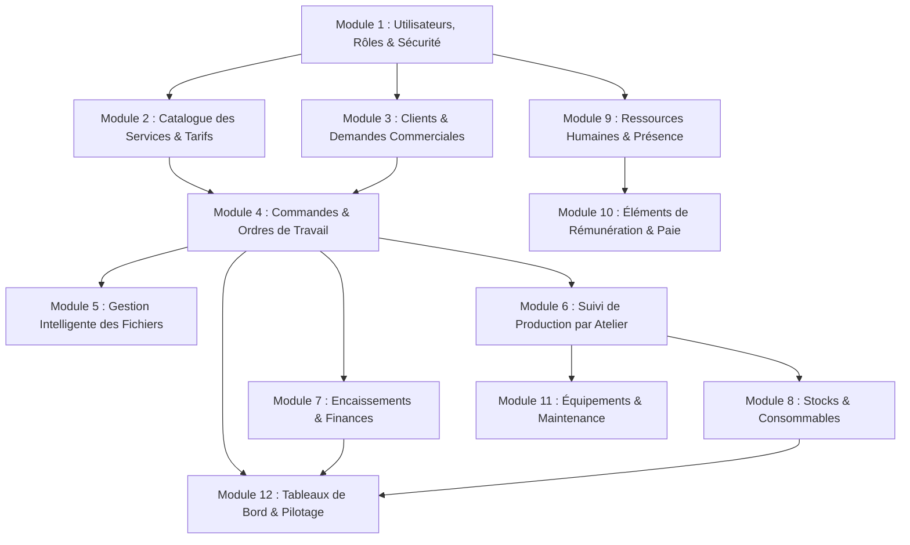

# 🏛️ DÉCOUPAGE DES MODULES ET ARCHITECTURE TECHNIQUE

Ce document détaille la subdivision modulaire de l'application **Africa Print Communication (APC)**.
Il sert de feuille de route pour placer les fichiers au bon endroit dans `BACKEND_LARAVEL/` et `FRONTEND_FLUTTER/`.

---

## 1. Découpage Modulaire et Ordre de Dépendance

---

## 2. Détail de chaque Module

### Module 1 — Utilisateurs, Rôles & Sécurité (Socle)
- **Rôle** : Authentification des collaborateurs, attribution des rôles par service et permissions granulaires vérifiées côté serveur.
- **Entités clés** : `User`, `Role`, `Permission`, `Department` (Services : Secrétariat, PAO, Numérique Grand Format, Sérigraphie/Offset, Finition, Comptabilité, Direction).
- **Emplacement Backend** :
  - `app/Domain/Auth/`
  - `app/Http/Controllers/Api/V1/AuthController.php`
  - `app/Http/Controllers/Api/V1/UserController.php`

### Module 2 — Catalogue des Services & Tarifs (Configurable)
- **Rôle** : Prestations réelles de l'imprimerie (bâche 440g, vinyle polymère, micro-perforé, papier photo, tee-shirt sérigraphié, etc.). Unités paramétrables (m², unité, forfait, rouleau).
- **Entités clés** : `ServiceCategory`, `PrintService`, `PricingRule`, `Unit`.
- **Emplacement Backend** :
  - `app/Domain/Catalog/`
  - `app/Http/Controllers/Api/V1/CatalogController.php`

### Module 3 — Clients, Demandes & Suivi Commercial
- **Rôle** : Répertoire client, enregistrement du canal d'entrée (WhatsApp, téléphone, guichet, email), qualification des demandes avant transformation en commande.
- **Entités clés** : `Customer`, `Inquiry`, `InquiryMessage`.
- **Emplacement Backend** :
  - `app/Domain/Customers/`
  - `app/Http/Controllers/Api/V1/CustomerController.php`
  - `app/Http/Controllers/Api/V1/InquiryController.php`

### Module 4 — Commandes & Ordres de Travail (Fiches Suiveuses)
- **Rôle** : Le cœur de l'entreprise. Une commande client regroupe les travaux et génère des ordres de travail (OT) envoyés aux services de production.
- **Entités clés** : `Order`, `OrderItem`, `WorkOrder`, `OrderStatusHistory`.
- **Statuts** : Reçu -> Qualifié -> Confirmé -> En préparation -> En production -> En contrôle -> Prêt -> Livré -> Clôturé.
- **Emplacement Backend** :
  - `app/Domain/Orders/`
  - `app/Http/Controllers/Api/V1/OrderController.php`
  - `app/Http/Controllers/Api/V1/WorkOrderController.php`

### Module 5 — Gestion & Traitement Intelligent des Fichiers (Priorité Clé)
- **Rôle** : Réception des fichiers, conservation immuable de l'original, analyse asynchrone (dimensions réelles, DPI, nombre de pages), génération d'aperçus légers, détection des anomalies vs commande.
- **Entités clés** : `FileAsset`, `FileVersion`, `FileAnalysisResult`.
- **Emplacement Backend** :
  - `app/Domain/Files/`
  - `app/Jobs/AnalyzePrintFileJob.php`
  - `app/Jobs/GenerateThumbnailJob.php`
  - `app/Http/Controllers/Api/V1/FileController.php`

### Module 6 — Suivi de Production par Atelier
- **Rôle** : File de travail par service (tablettes / ordinateurs des machinistes), suivi d'avancement, déclarations d'incidents (machine en panne, défaut d'encre), validation du contrôle qualité.
- **Entités clés** : `ProductionStep`, `QualityCheck`, `IncidentReport`.
- **Emplacement Backend** :
  - `app/Domain/Production/`
  - `app/Http/Controllers/Api/V1/ProductionController.php`

### Module 7 — Encaissements & Suivi Financier
- **Rôle** : Enregistrement des acomptes, paiements partiels, soldes, moyens de paiement (espèces, chèques, virement, Mobile Money). Calcul du solde restant dû par commande.
- **Entités clés** : `Payment`, `PaymentMethod`, `Invoice`.
- **Emplacement Backend** :
  - `app/Domain/Finance/`
  - `app/Http/Controllers/Api/V1/PaymentController.php`

### Module 8 — Stocks, Consommables & Mouvements
- **Rôle** : Suivi des matières premières (rouleaux de vinyle, bâches, œillets, encres solvants/UV). Mouvements d'entrée/sortie, consommations liées aux ordres de travail, alertes de seuil minimum.
- **Entités clés** : `StockItem`, `StockCategory`, `StockMovement`, `StockThreshold`.
- **Emplacement Backend** :
  - `app/Domain/Inventory/`
  - `app/Http/Controllers/Api/V1/InventoryController.php`

### Module 9 — Ressources Humaines, Pointage & Absences
- **Rôle** : Profils employés, pointage journalier d'arrivée/départ, suivi des retards, demandes de congés ou d'absences avec workflow de validation.
- **Entités clés** : `Employee`, `AttendanceRecord`, `LeaveRequest`.
- **Emplacement Backend** :
  - `app/Domain/Hr/`
  - `app/Http/Controllers/Api/V1/AttendanceController.php`
  - `app/Http/Controllers/Api/V1/LeaveController.php`

### Module 10 — Rémunération & Gestion de la Paie
- **Rôle** : Données hautement confidentielles (accès restreint). Salaires de base, primes, retenues, acomptes sur salaire et validation mensuelle.
- **Entités clés** : `PayrollPeriod`, `SalarySlip`, `PayrollItem`.
- **Emplacement Backend** :
  - `app/Domain/Payroll/`
  - `app/Http/Controllers/Api/V1/PayrollController.php`

### Module 11 — Équipements & Maintenance
- **Rôle** : Inventaire des traceurs, presses numériques, massicots, laminateurs. Historique des révisions et carnets de maintenance.
- **Entités clés** : `Equipment`, `MaintenanceTask`.
- **Emplacement Backend** :
  - `app/Domain/Maintenance/`
  - `app/Http/Controllers/Api/V1/EquipmentController.php`

### Module 12 — Tableaux de Bord & Pilotage (Reporting)
- **Rôle** : Indicateurs synthétiques en temps réel selon le profil de l'utilisateur connecté (Commandes en cours, CA du jour, travaux bloqués, alertes stocks).
- **Emplacement Backend** :
  - `app/Domain/Dashboard/`
  - `app/Http/Controllers/Api/V1/DashboardController.php`
