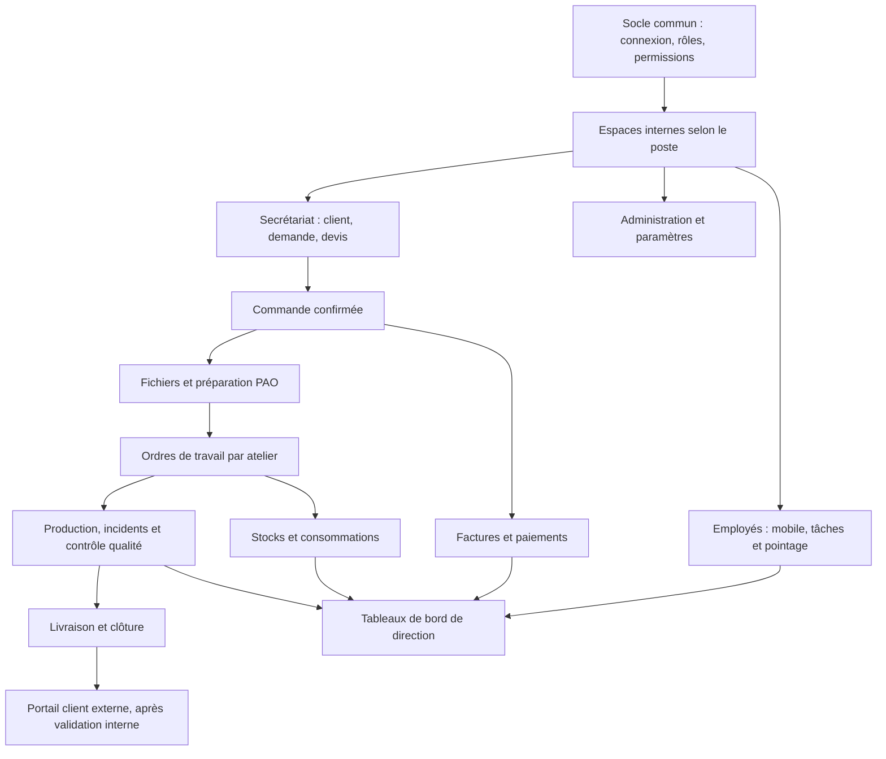

# Plan visuel du projet APC

Ce document est le tableau de bord de suivi. Les fonctions marquées « prototype » existent partiellement, mais ne constituent pas encore un flux métier complet. Les modules non commencés ne doivent pas être présentés comme opérationnels.

## Parcours global



## État et ordre de réalisation

| Étape | Périmètre | État |
|---|---|---|
| 0 | API Laravel, base PostgreSQL, connexion et rôles | Terminé, à maintenir testé |
| 1 | Catalogue, répertoire clients, demandes et devis du secrétariat | Prototype connecté à l’API; à valider avec les utilisateurs |
| 2 | Espaces internes adaptés aux rôles et permissions | Structure par fonctionnalité livrée; secrétariat et production utilisables; espaces direction/comptabilité/PAO explicitement en préparation |
| 3 | Flux secrétariat complet : demande, devis, commande et suivi client | Demande/devis disponible; conversion API vers une vraie commande livrée; bouton de conversion dans l’interface secrétariat à faire |
| 4 | Commandes, ordres de travail et affectation aux ateliers | Première tranche API livrée : commande, ordre par atelier, file départementale et transitions; interface production desktop/mobile livrée |
| 5 | Fichiers d’impression, préparation PAO, production et contrôle qualité | File et transitions d’atelier démarrées; fichiers, analyse, instructions détaillées et contrôle qualité à faire |
| 6 | Espace mobile employé : pointage, missions, incidents et notifications | À faire |
| 7 | Administration, comptabilité, paiements et facturation | À faire |
| 8 | Stocks, consommations, équipements et maintenance | À faire |
| 9 | Tableaux de bord par rôle et diagnostics | À faire, à alimenter par les modules précédents |
| 10 | Portail client externe | Reporté après validation des parcours internes |

## Écrans par profil

| Profil | Poste principal | Espace attendu |
|---|---|---|
| Secrétariat / commercial | Desktop | Demandes, clients, devis, commandes et communication |
| Direction / administration | Desktop | Utilisateurs, rôles, paramètres et pilotage |
| Comptabilité | Desktop | Factures, paiements, soldes et rapports autorisés |
| Graphiste / PAO | Desktop ou poste atelier | Fichiers à préparer, consignes et validation des fichiers |
| Machiniste / opérateur | Mobile ou poste atelier | Ordres affectés, étapes, incidents, consommations et contrôle |
| Employé | Mobile | Pointage, profil, missions, absences et notifications |

Le frontend est organisé sous `FRONTEND_FLUTTER/lib/` par `app/`, `core/`, `features/` et `shared/`. L’espace secrétaire existant est isolé; l’espace machiniste possède des vues desktop et mobile séparées. La direction, la comptabilité et la PAO ont leurs propres dossiers et pages d’attente, sans fausses données métier. Les permissions UI filtrent les appels, et l’API Laravel reste l’autorité finale.

## Organisation du code

```text
FRONTEND_FLUTTER/lib/
    app/                         composition, thème et contrôleurs de session
    core/                        palette, rôles, formatage
    data/                        client HTTP commun
    features/
        auth/                       connexion : application, data, presentation
        secretariat/                clients, demandes, catalogue : couches séparées
        production/                 ordres : domaine, dépôt, contrôleur, écrans desktop/mobile
        administration/presentation/ espace direction (en préparation)
        accounting/presentation/     espace comptabilité (en préparation)
        prepress/presentation/       espace PAO (en préparation)
        workspace/presentation/      navigation selon rôle et format
    shared/presentation/           composants visuels partagés
```

`FRONTEND_FLUTTER/lib/apc_app.dart` reste une façade de compatibilité pour les imports existants. Android/iOS, Web et desktop partagent le domaine et les dépôts; les présentations peuvent différer par rôle et facteur de forme. Pas besoin de dupliquer le projet Flutter par système d’exploitation.

Laravel suit les responsabilités MVC par ressource/domaine : modèles Eloquent, contrôleurs HTTP API versionnés, services pour les opérations métier et Form Requests pour autorisation/validation. Les rôles ne nécessitent pas des copies de contrôleurs : les permissions sont contrôlées dans les requests/contrôleurs, tandis que les routes sont maintenant rangées dans `BACKEND_LARAVEL/routes/api/v1/` par domaine.

## Vérifications à chaque étape

1. Se connecter avec un compte de test de chaque rôle et vérifier le nom de l’espace affiché.
2. Vérifier que seules les rubriques autorisées apparaissent et que les appels API interdits ne sont pas lancés. Le backend reste l’autorité finale pour les permissions.
3. Avec le compte secrétariat, créer une demande, la qualifier, enregistrer l’envoi du devis, puis vérifier les données après actualisation.
4. Depuis l’API, convertir une demande avec devis envoyé, vérifier client, montant, département et ordre généré; l’action UI secrétariat reste à relier.
5. Avec un compte machiniste, vérifier qu’il ne voit que les travaux non affectés ou ceux de son département/personne, et qu’une mise à jour d’étape est conservée.
6. Contrôler les mêmes parcours sur grand écran et sur téléphone; ne valider le mobile que lorsque les écrans sont réellement adaptés à son usage.

## Conditions pour déclarer le projet prêt à l’usage

- Chaque rôle possède un parcours métier utilisable, pas seulement un menu ou un tableau d’attente.
- Les autorisations sont appliquées et testées côté API, y compris pour les actions directes.
- Les données restent cohérentes entre demandes, clients, commandes, production et paiements.
- Les tests automatisés passent et les scénarios réels ci-dessus sont vérifiés sur les appareils ciblés.
- Les modules non livrés et les blocages de configuration restent visibles dans ce plan.

## État base locale

Les migrations `orders` et `work_orders` sont présentes mais n’ont pas été appliquées à la base PostgreSQL locale. Les tests fonctionnels utilisent leur base de test isolée. Appliquer les migrations en local uniquement après vérification/sauvegarde de la base voulue.